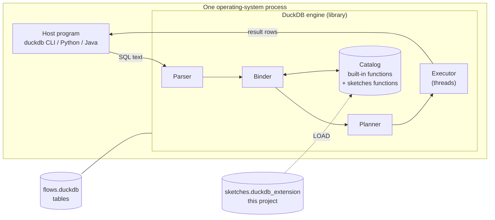
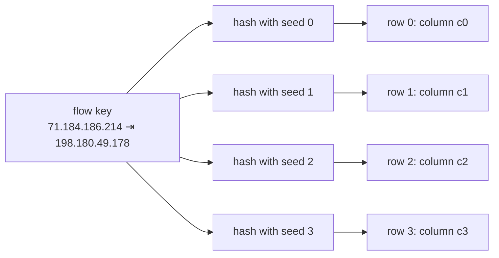
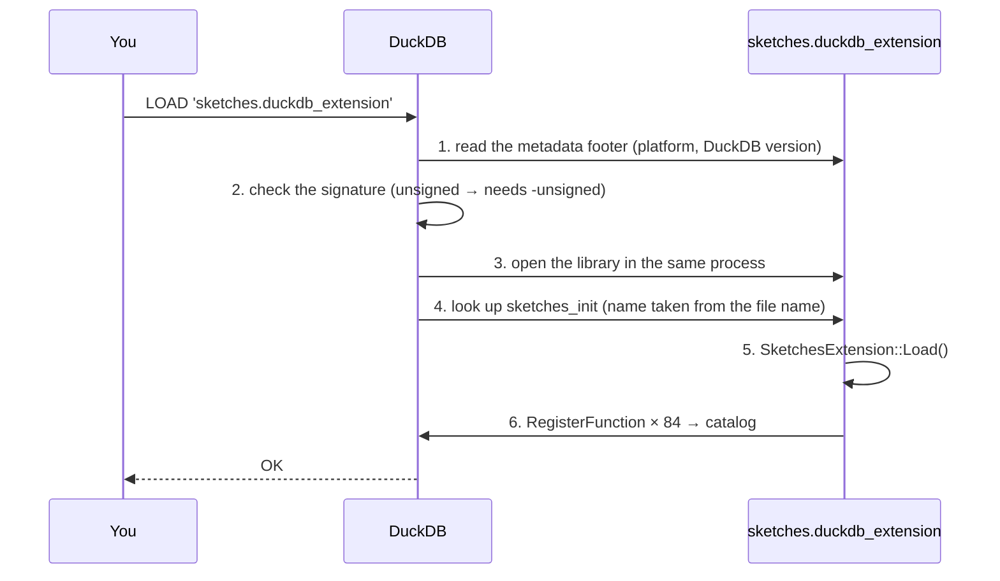
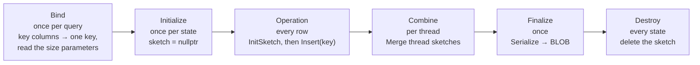
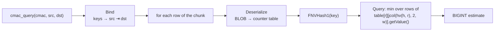

# Sketches: Flow-Size Estimation Sketches for DuckDB

A DuckDB extension that brings **12 frequency-estimation sketches** into SQL: the
**SSVS** sketch from *Single Update Sketch with Variable Counter Structure* (PVLDB 2023)
and the 11 sketches it is compared against. Every sketch is built with one aggregate
function, stored as a single `BLOB`, and queried, updated or merged with scalar functions,
all in plain SQL.

```sql
-- One row per packet
CREATE TABLE ip_log AS
SELECT column0 AS src, column1 AS dst
FROM read_csv('o1.txt', sep = '\t', header = false);

-- Build an SSVS sketch over the whole trace
CREATE TABLE sketches AS
SELECT ssvs_agg(src, dst) AS ssvs FROM ip_log;

-- Estimate how many packets one flow sent
SELECT ssvs_query(ssvs, '71.184.186.214', '198.180.49.178') AS estimate FROM sketches;
```

| | |
|---|---|
| **Sketches** | 12: CM, CU, CS, CM-SC, CU-SC, CS-SC, CM-AC, CU-AC, CS-AC, RCS, RCS-AC, SSVS |
| **SQL functions** | 84 (7 per sketch: build, query, update, merge, and three timing functions) |
| **Memory** | 1 Mbit (2²⁰ = 1,048,576 bits) of counters per sketch by default, as in the paper |
| **Flow keys** | Any number of columns of any type |
| **Hashing and layouts** | Same as the paper's Java reference implementation |
| **Parallel builds** | Yes: 3.8–4.6× faster with 8 threads ([details](#9-merging-and-parallel-builds)) |
| **DuckDB version** | v1.2.0 (pre-1.4 C++ extension API, see [DuckDB version](#duckdb-version)) |
| **Status** | Built and tested locally; not yet submitted to the DuckDB community extensions repository |

### Headline results

On a 16.8 million packet network trace, with every sketch built on one thread and limited
to 1 Mbit of counters:

- **SSVS has the lowest error** of all 12 sketches (85.98 packets on average), 19% lower
  than the next best (CS-AC).
- **SSVS is the third fastest** (70.7 ns per packet), behind only RCS and RCS-AC, which have
  4.6–5.7× its error.
- These results support the trade-off reported in the SSVS paper, although several
  numbers differ from the paper's (see [Results](#13-results)).


---

## Table of contents

1. [Background](#1-background)
2. [The 12 sketches](#2-the-12-sketches)
3. [Quick start](#3-quick-start)
4. [Building from source](#4-building-from-source)
5. [Loading the extension](#5-loading-the-extension)
6. [Using the extension](#6-using-the-extension)
7. [SQL function reference](#7-sql-function-reference)
8. [How it works](#8-how-it-works)
9. [Merging and parallel builds](#9-merging-and-parallel-builds)
10. [Faithfulness to the reference implementation](#10-faithfulness-to-the-reference-implementation)
11. [Testing](#11-testing)
12. [Reproducing the results](#12-reproducing-the-results)
13. [Results](#13-results)
14. [Challenges and fixes](#14-challenges-and-fixes)
15. [Repository layout](#15-repository-layout)
16. [Limitations and future work](#16-limitations-and-future-work)
17. [References](#17-references)
18. [Authors and license](#18-authors-and-license)

---

## 1. Background

### DuckDB

[DuckDB](https://duckdb.org) is an embedded (in-process) analytical SQL database. There is
no separate database server: the DuckDB engine is a library that runs inside the program
that uses it, whether that is the `duckdb` command-line shell, a Python script or a Java
application. That same program parses, plans and executes the SQL, using several threads,
and gets the result rows back directly.



DuckDB was a good fit for this project because:

- there is **no server** to install or manage;
- it **reads CSV and Parquet files directly**;
- it **runs aggregate functions in parallel** across all CPU cores;
- new **C++ functions can be added through extensions**.

A sketch can therefore be built over a whole trace with one SQL statement, and then queried,
updated or merged with ordinary SQL.

### DuckDB extensions

Extensions add new functions, types and file formats to DuckDB without changing its core.
An extension is a shared library. When it is loaded, it registers its functions in
DuckDB's **catalog**, and from then on SQL calls them like built-in functions.

This repository started from the official
[DuckDB extension template](https://github.com/duckdb/extension-template), which supplies the
CMake build, the test runner and the CI configuration.

### The problem: per-flow size estimation

A network link carries millions of packets per second. Each packet belongs to a **flow**,
here all of the traffic between one source and destination IP address pair. A flow's
**count** (or size) is the number of packets in it. *Per-flow size estimation* asks for
each flow's count.

Counting exactly needs one counter per flow, and there can be millions of flows. A **sketch**
answers the same question approximately from a small, fixed amount of memory: a table of
counters that many flows share. Every packet is hashed to a few counters and raises them.
To answer a query, the sketch reads the same counters back. Flows that share a counter
add noise to each other's estimates, and the sketches differ in how they keep that noise
down and how much work each packet costs.

The same technique applies to anything that needs counts of many distinct items: page views
per URL, queries per user, events per device.

### The paper

> Dimitrios Melissourgos, Haibo Wang, Shigang Chen, Chaoyi Ma, and Shiping Chen.
> **Single Update Sketch with Variable Counter Structure.**
> *Proceedings of the VLDB Endowment*, 16(13): 4296–4309, 2023.
> https://doi.org/10.14778/3625054.3625065

The paper divides sketches into two families:

- **multi-update sketches**, such as Count-Min, update several counters per packet: accurate
  but slower;
- **single-update sketches**, such as RCS, update one counter per packet: faster but noisier.

It proposes **SSVS**, which updates only **one** counter per packet (fast) but uses
**variable-size counters** that start small and grow only as needed (so many more counters
fit in memory, and it is accurate). It compares SSVS against 11 other sketches, all at
1 Mbit of memory. The authors' Java code is at https://github.com/DimitrisMel/SSVS.

### What this project adds

The sketch algorithms, their parameters, the hash functions and the counter layouts follow
the paper's Java reference implementation, so the results can be compared with the paper's.
Everything needed to use the sketches inside a database was developed for this project:

- a **C++ implementation** of all 12 sketches and their counters;
- a **SQL interface** of 84 aggregate and scalar functions that build, query, update and
  merge sketches, with keys made of any number of columns;
- a **serialization format** that stores a whole sketch as one `BLOB`, so it can be saved in
  a table and used later;
- **merge routines** for every counter type, which let DuckDB build a sketch on several
  threads at once and let users combine sketches built at different times;
- **timing functions and SQL test scripts** for checking correctness, merging, accuracy
  and speed.

---

## 2. The 12 sketches

### Overview table

Every sketch fits in 1 Mbit by default. The SQL prefix is the start of its seven function
names, so Count-Min is built with `countmin_agg` and queried with `countmin_query`.

| Sketch | SQL prefix | Writes per packet | Counter | Default size | Estimate |
|---|---|---|---|---|---|
| Count-Min (CM) | `countmin` | 4 (one per row) | 32-bit integer | 4 × 8,192 | minimum of 4 counters |
| Conservative Update (CU) | `cu` | 1–4 (rows at the minimum) | 32-bit integer | 4 × 8,192 | minimum of 4 counters |
| Count Sketch (CS) | `countsketch` | 4 | 32-bit signed | 4 × 8,192 | median of 4 signed counters |
| CM with self-adjusting counters (CM-SC) | `cmsc` | 4 | SAC64, 36 bits, up to 4 counters | 4 × 7,281 cells | minimum |
| CU with self-adjusting counters (CU-SC) | `cusc` | 1–4 | SAC64 | 4 × 7,281 cells | minimum |
| CS with self-adjusting counters (CS-SC) | `cssc` | 4 | SAC64, signed | 4 × 7,281 cells | median |
| CM with active counters (CM-AC) | `cmac` | 4 | AC16, 16-bit | 4 × 16,384 | minimum |
| CU with active counters (CU-AC) | `cuac` | 1–4 | AC16 | 4 × 16,384 | minimum |
| CS with active counters (CS-AC) | `csac` | 4 | AC16, signed | 4 × 16,384 | median |
| Randomized Counter Sharing (RCS) | `rcs` | **1** | 32-bit integer | 4 × 8,192 | sum of 4 counters minus noise |
| RCS with active counters (RCS-AC) | `rcsac` | **1** | AC8, 8-bit | 131,072 (512 hash seeds) | corrected sum of 512 counters |
| **SSVS** (the paper's sketch) | `ssvs` | **1** | VC, 18-bit variable | 58,254 cells, 4 seeds | min-gap average of 4 signed counters |

The sketches combine two independent choices:

- an **update rule** (how many counters a packet touches, and how the estimate is read): CM, CU, CS, RCS or SSVS;
- a **counter type** (how one counter is stored): plain 32-bit, self-adjusting (SC), active (AC) or variable (VC).

Smaller counters fit more counters into the same 1 Mbit, which means fewer flows share a
counter and the estimates are less noisy.

### Update rules: CM, CU and CS

All three use a table of `d` rows by `w` columns (default 4 × 8,192). Each row has its own
hash seed, so a flow lands in a different column in each row.



| | Insert | Query | Error |
|---|---|---|---|
| **CM** | add 1 to the flow's counter in every row | smallest of the 4 counters | never below the true count; other flows can only push counters up |
| **CU** | read the 4 counters, add 1 to **every** counter equal to the minimum (all of them if several tie) | smallest of the 4 counters | never below the true count, and less over-counting than CM |
| **CS** | add +1 or −1 (chosen by a second hash) in every row | multiply each of the 4 counters by the flow's sign in that row, take the median | collisions cancel out on average, but an estimate can be too high or too low |

### Counter types: plain, self-adjusting and active

Most flows are small, so most counters never need 32 bits. The two compact counter types
keep counters small until a flow actually grows.

**Plain counters** are ordinary 32-bit integers: 8,192 per row in 1 Mbit.

**Self-adjusting counters (SC, `SAC64`)** use 36 bits per cell: a 32-bit field `C` and a
4-bit indicator `I`. A cell starts as four independent 8-bit signed counters (±127). When one
overflows, it merges with its neighbour into a 16-bit counter that both share. When a
16-bit counter overflows, the cell becomes one 32-bit counter. At 7,281 cells per row, a
row holds up to 29,124 small counters.

| Stage | Layout of the 32-bit field | Counters per cell | Range |
|---|---|---|---|
| `I = 0` | four 8-bit sub-counters (bit 0 sign, bits 1–7 value) | 4 | ±127 each |
| pair promoted | two sub-counters merged into a 16-bit counter | 2 or 3 | ±32,767 |
| fully promoted | one 32-bit counter | 1 | ±2³¹−1 |

**Active counters (AC, `AC16`)** are 16 bits: a sign bit, a 10-bit value `v` and a 5-bit
exponent `e`. The counter stands for **±v × 2^e**, so 16,384 counters fit in each row.

```
bit:  15 14 13 12 11 | 10  9  8  7  6  5  4  3  2  1 |  0
      exponent e     |  value v (10 bits)             | sign
      0  0  0  1  1  |  1  0  1  0  1  1  1  1  0  0 |  1   →  +700 × 2³ = 5,600
```

- **Probabilistic counting.** An insert changes the counter only with probability
  1 / 2^e, and when it does, `v` grows by one, which is worth 2^e. On average a packet
  still adds exactly 1.
- **Overflow.** When all ten value bits are 1 (1,023 × 2⁰), the next increment sets `v` to
  512 and adds 1 to the exponent: 512 × 2¹ = 1,024.
- Below 1,024 the exponent is 0 and every packet counts, so small flows are counted exactly.

**AC8**, used only by RCS-AC, is an unsigned 8-bit active counter with a 4-bit value and a
4-bit exponent.

### Single-update sketches: RCS, RCS-AC and SSVS

Multi-update sketches touch 4 counters per packet. Single-update sketches pick **one** of
the flow's counters at random and update only that one, which makes them much faster.

| | Insert | Query |
|---|---|---|
| **RCS** | pick one of the 4 rows at random, add 1 to the flow's counter in that row | add up the flow's 4 counters and subtract the expected noise `n / w` (`n` = packets inserted) |
| **RCS-AC** | pick one of 512 hash seeds at random and raise that AC8 counter in a flat array of 131,072 | `(w·l)/(w−l) · (sum/l − n/w)`, a correction for the shared array, with `l = 512` |
| **SSVS** | pick one of 4 seeds at random; the hash picks a cell, a sub-counter and a sign (±1) | sort the 4 signed readings, start from the two closest, add the others within `h` of the nearer of the two, scale up to 4 readings, clamp at 0 |

**SSVS's variable counter (VC)** uses 18 bits per cell (16 bits + a 2-bit stage indicator),
58,254 cells in 1 Mbit:

| Stage `I` | Meaning | Range |
|---|---|---|
| `0` | two independent signed 8-bit counters | ±127 each |
| `1` | one signed 16-bit counter | ±32,767 |
| `2` | small active counter: 3-bit exponent, sign, 12-bit value | up to ±4,095 × 2⁷ |
| `3` | large active counter: 5-bit exponent, sign, 10-bit value | larger still |

**SSVS's noise threshold `h`.** The query needs an estimate of the background noise. It is
the average reading of 20,000 randomly chosen counters (negative readings count as 0),
divided by the strictness parameter `k` (default 4). It is computed when sketches are
merged, or on the first query if it has not been computed yet.

---

## 3. Quick start

```bash
git clone --recurse-submodules https://github.com/kmsprague/DuckDB_Sketches_Community_Extension.git
cd DuckDB_Sketches_Community_Extension
make                      # or: GEN=ninja make
./build/release/duckdb    # a DuckDB shell with the extension already linked in
```

```sql
-- Count words with a Count-Min sketch
CREATE TABLE words AS
SELECT unnest(['apple', 'banana', 'apple', 'cherry', 'apple', 'banana']) AS word;

SELECT countmin_query(countmin_agg(word), 'apple') AS apples FROM words;   -- 3
```

---

## 4. Building from source

### Prerequisites

| Tool | Notes |
|---|---|
| Git | to clone the repository and its submodules |
| A C++17 compiler | GCC 9+, Clang 10+, Apple Clang (Xcode command-line tools) or MSVC 2019+ |
| CMake 3.5+ | https://cmake.org/download/ (macOS: `brew install cmake`) |
| Make | Ninja is optional and faster: `brew install ninja` / `apt install ninja-build` |
| Python 3 | used by DuckDB's build scripts |

### DuckDB version

The extension uses DuckDB's **pre-1.4 C++ extension API**:

- the entry point is `sketches_init(DatabaseInstance &)`;
- `SketchesExtension::Load(DuckDB &)`;
- functions are registered with `ExtensionUtil::RegisterFunction`.

DuckDB v1.4 replaced this with `ExtensionLoader`, so the `duckdb` and `extension-ci-tools`
submodules are pinned to a matching release. The extension is built and tested against
**DuckDB v1.2.0**. Cloning with `--recurse-submodules` checks out the pinned versions; if
you cloned without it, run:

```bash
git submodule update --init --recursive
```

> A loadable extension only loads into the exact DuckDB version and platform it was built
> for. An extension built here loads into DuckDB v1.2.0 (CLI, or Python `duckdb==1.2.0`).

### Build

```bash
make                 # release build
GEN=ninja make       # same, faster, with Ninja
make debug           # debug build in build/debug
```

The first build compiles DuckDB itself and takes a while (10–30 minutes). Later builds only
recompile the extension.

### Build outputs

| File | What it is |
|---|---|
| `build/release/duckdb` | DuckDB shell with the extension **statically linked**; no `LOAD` needed |
| `build/release/extension/sketches/sketches.duckdb_extension` | the **loadable** extension, for `LOAD` in DuckDB v1.2.0 |
| `build/release/test/unittest` | DuckDB's test runner, with the extension linked in |

---

## 5. Loading the extension

**Option 1: the bundled shell.** `./build/release/duckdb` already contains the extension.

```bash
./build/release/duckdb flows.duckdb     # open (or create) a database file
```

**Option 2: `LOAD` into DuckDB v1.2.0.** Self-built extensions are not signed by DuckDB, so
unsigned extensions must be allowed when DuckDB starts.

```bash
duckdb -unsigned flows.duckdb
```
```sql
LOAD 'build/release/extension/sketches/sketches.duckdb_extension';
```

The extension stays loaded until the program closes, so run `LOAD` again in each new session.

From Python:

```python
import duckdb   # pip install duckdb==1.2.0
con = duckdb.connect('flows.duckdb', config={'allow_unsigned_extensions': 'true'})
con.sql("LOAD 'build/release/extension/sketches/sketches.duckdb_extension'")
print(con.sql("SELECT countmin_query(countmin_agg(x), 'a') FROM (VALUES ('a'), ('a'), ('b')) t(x)"))
```

**Option 3 (future): the community repository.** Once the extension has been submitted and
accepted, it will install without building:

```sql
INSTALL sketches FROM community;
LOAD sketches;
```

### What `LOAD` does



`sketches_extension.cpp` holds steps 4–6:

```cpp
extern "C" {
DUCKDB_EXTENSION_API void sketches_init(duckdb::DatabaseInstance &db) {
    duckdb::DuckDB dbWrapper(db);
    duckdb_sketches::SketchesExtension extension;
    extension.Load(dbWrapper);            // registers all 84 functions
}
}
```

---

## 6. Using the extension

### The pattern: build, store, query

1. **Build** a sketch with an aggregate. The aggregate reads every row and returns the whole
   sketch as a single `BLOB`.
2. **Store** the `BLOB` in a table, like any other value.
3. **Query** it with a scalar function. Estimate one flow, or every flow in a table with a join.

```sql
-- 0. Input: one row per packet
CREATE TABLE ip_log AS
SELECT column0 AS src, column1 AS dst
FROM read_csv('o1.txt', sep = '\t', header = false);

-- 1-2. Build all 12 sketches in one pass and store them (one row, 12 BLOB columns)
CREATE TABLE sketches AS
SELECT countmin_agg(src, dst)    AS cm,
       cu_agg(src, dst)          AS cu,
       countsketch_agg(src, dst) AS cs,
       cmsc_agg(src, dst)        AS cmsc,
       cusc_agg(src, dst)        AS cusc,
       cssc_agg(src, dst)        AS cssc,
       cmac_agg(src, dst)        AS cmac,
       cuac_agg(src, dst)        AS cuac,
       csac_agg(src, dst)        AS csac,
       rcs_agg(src, dst)         AS rcs,
       rcsac_agg(src, dst)       AS rcsac,
       ssvs_agg(src, dst)        AS ssvs
FROM ip_log;

-- 3a. One flow
SELECT ssvs_query(ssvs, '71.184.186.214', '198.180.49.178') AS estimate FROM sketches;

-- 3b. Every flow, next to its true count
CREATE TABLE truth AS SELECT src, dst, count(*) AS n FROM ip_log GROUP BY src, dst;

SELECT t.src, t.dst, t.n AS true_count,
       ssvs_query(s.ssvs, t.src, t.dst) AS estimate
FROM truth t, sketches s;
```

The sketch column (`ssvs` above) is passed to every query because a sketch is just a value
stored in a column, like any other argument. The functions keep nothing between calls, and
one table can hold many sketches.

> **Accuracy tip.** CU-based sketches (CU, CU-SC, CU-AC) are most accurate when built on one
> thread: run `SET threads = 1;` before building them. See
> [Merging and parallel builds](#9-merging-and-parallel-builds).

### Flow keys: any columns, any types

The flow key is **every argument before the size parameters**. Columns of any type are
converted to text and joined with a TAB character, the same way the paper's Java code builds
a flow ID from the fields of an input line:

```sql
countmin_agg(src, dst)                 -- key = src || '\t' || dst
countmin_agg(src, dst, sport, dport)   -- four-column key; integers are fine
countmin_agg(user_id)                  -- one column
```

Query with **the same columns in the same order** as the build. A different order is a
different key.

### Sketch sizes

Integer **constants** after the key columns set the size. Columns are never taken as size
parameters, only literal constants.

| Sketches | Parameters | Defaults (1 Mbit) | Limits |
|---|---|---|---|
| CM, CU, CS | `(depth, width)` | 4, 8,192 | depth 1–64, width 8–16,777,216 |
| CM-SC, CU-SC, CS-SC | `(depth, width)` | 4, 7,281 | same |
| CM-AC, CU-AC, CS-AC | `(depth, width)` | 4, 16,384 | same |
| RCS | `(l, width)` | 4, 8,192 | l 1–512 |
| RCS-AC | `(l, width)` | 512, 131,072 | l 1–512 |
| SSVS | `(l, m, k)` | 4, 58,254, 4 | l 1–64, m 8–16,777,216, k ≥ 1 |

```sql
-- Twice the default memory (2 Mbit)
SELECT countmin_agg(src, dst, 4, 16384) AS cm,
       ssvs_agg(src, dst, 4, 116508, 4)  AS ssvs
FROM ip_log;
```

### One sketch per group

Because the sketches are aggregates, `GROUP BY` builds one sketch per group:

```sql
-- One sketch per hour of traffic
CREATE TABLE hourly AS
SELECT date_trunc('hour', ts) AS hour, cmac_agg(src, dst) AS cmac
FROM ip_log GROUP BY ALL;
```

### Updating a stored sketch

`xxx_update(sketch, key...)` returns a **new** `BLOB` with one more packet for that flow. The
stored sketch does not change until you write the result back:

```sql
UPDATE sketches SET cm = countmin_update(cm, '10.0.0.1', '10.0.0.2');
```

To add many packets at once, build a sketch from them and merge it in. This is much faster
than repeated updates, because every update call deserializes and re-serializes the whole
sketch:

```sql
UPDATE sketches SET cm = countmin_merge(cm, (SELECT countmin_agg(src, dst) FROM new_packets));
```

### Merging stored sketches

`xxx_merge(a, b)` combines two sketches of the **same type, size and hash seeds**, for
example one per file or per day:

```sql
SELECT countmin_query(countmin_merge(a.cm, b.cm), '10.0.0.1', '10.0.0.2')
FROM day1 a, day2 b;
```

How each counter type merges, and how exact the result is, is covered in
[section 9](#9-merging-and-parallel-builds).

### NULL handling

- Rows whose key is `NULL` (including a `NULL` in any key column) are skipped while building.
- An empty input gives a `NULL` sketch.
- A query with a `NULL` sketch or a `NULL` key returns `NULL`.

---

## 7. SQL function reference

Every sketch has the same seven functions. Replace `xxx` with the prefix from the
[overview table](#overview-table) (`countmin`, `cu`, `countsketch`, `cmsc`, `cusc`, `cssc`,
`cmac`, `cuac`, `csac`, `rcs`, `rcsac`, `ssvs`).

| Function | Kind | Arguments | Returns | Purpose |
|---|---|---|---|---|
| `xxx_agg` | aggregate | `key1 [, key2 ...] [, size params]` | `BLOB` | build a sketch from all rows |
| `xxx_query` | scalar | `sketch BLOB, key1 [, key2 ...]` | `BIGINT` | estimated count for one flow |
| `xxx_update` | scalar | `sketch BLOB, key1 [, key2 ...]` | `BLOB` | a new sketch with one more packet |
| `xxx_merge` | scalar | `a BLOB, b BLOB` | `BLOB` | combine two sketches |
| `xxx_agg_timed` | aggregate | same as `xxx_agg` | `STRUCT` | build the sketch and measure the per-packet insert time over the whole input |
| `xxx_update_timed` | scalar | `sketch BLOB, key1 [, key2 ...]` | `STRUCT` | microbenchmark: one flow inserted 100,000 times (cache-hot) |
| `xxx_query_timed` | scalar | `sketch BLOB, key1 [, key2 ...]` | `STRUCT` | microbenchmark: one flow queried 10,000 times |

12 sketches × 7 functions = **84 SQL functions**.

### Timing function results

`xxx_agg_timed` returns `STRUCT(sketch BLOB, insert_ns DOUBLE, packets BIGINT, total_ms DOUBLE)`:

| Field | Meaning |
|---|---|
| `sketch` | exactly the same sketch `xxx_agg` builds |
| `insert_ns` | total insert time ÷ packets: nanoseconds per packet |
| `packets` | rows inserted |
| `total_ms` | total insert time in milliseconds (inserts only, not the whole SQL statement) |

The timer runs around each chunk of up to 2,048 rows that DuckDB passes to the aggregate,
and covers only the inserts (hashing and counter updates), not reading the table or building
the keys. With more than one thread, the times of all threads are added together, so measure
per-packet time with `SET threads = 1`.

`xxx_update_timed` returns `STRUCT(sketch, insert_ns, insert_ns_min, inserts_per_run, hash_ns, hashes_per_insert)`:

| Field | Meaning |
|---|---|
| `insert_ns` | median over 5 runs of 100,000 inserts, ns per insert |
| `insert_ns_min` | fastest run |
| `hash_ns` | one key hash on its own |
| `hashes_per_insert` | key hashes per insert: 1 (RCS, RCS-AC, SSVS), 4 (multi-update), more for CU-SC/CU-AC |

`xxx_query_timed` returns `STRUCT(estimate BIGINT, query_ns, query_ns_min, queries_per_run, hash_ns)`.

Read the fields with `(result).field`:

```sql
SET threads = 1;
SELECT (t).insert_ns, (t).packets
FROM (SELECT ssvs_agg_timed(src, dst) AS t FROM ip_log);
```

---

## 8. How it works

### Source files

| File | Role |
|---|---|
| `src/sketches_extension.cpp` | the entry point (`sketches_init`) and `Load()`, which registers all 84 functions |
| `src/include/sketches_extension.hpp` | declares the `SketchesExtension` class (`Load`, `Name`, `Version`) |
| `src/include/sketches_aggregate.hpp` | the sketches themselves: hash functions, counter types (`AC16`, `AC8`, `SAC64`, `VC`), the 12 sketch structs with `Insert` / `Query` / `Merge` / `Serialize` / `Deserialize`, and the DuckDB aggregate state and operation structs |
| `src/sketches_aggregate.cpp` | the DuckDB glue: bind functions (key columns and size parameters), the aggregate and scalar function factories, query/update/merge, and the timing functions |

### Scalar versus aggregate functions

| | Aggregate (`xxx_agg`) | Scalar (`xxx_query`, `xxx_update`, `xxx_merge`) |
|---|---|---|
| Rows in → rows out | many → one (per group) | one → one, for every row |
| Keeps state between rows | yes: the sketch being built | no: each call deserializes the sketch, uses it and frees it |
| DuckDB API | `AggregateFunction::UnaryAggregate<STATE, string_t, string_t, OP>` | `ScalarFunction(name, {BLOB, VARCHAR}, BIGINT, fn)` |

The DuckDB extension template only includes an example of a scalar function. The aggregate
lifecycle and registration were worked out from DuckDB's source code and existing extensions.

### The aggregate lifecycle

DuckDB calls the operation struct (for example `CMACOperation`) at fixed moments.



| Phase | What happens |
|---|---|
| **Bind** | Runs once while the query is planned. The key columns are cast to `VARCHAR` and joined with `'\t'` into one key expression. Trailing integer constants become the size, which is checked and stored with the row seeds. All threads share this object. |
| **Initialize** | Each state (one per thread for an ungrouped aggregate) starts with no sketch (`nullptr`). |
| **Operation** | For every row, the sketch is allocated on first use, then the key is inserted. |
| **ConstantOperation** | Used when a batch holds one repeated value; inserts it `n` times. |
| **Combine** | Each thread built its own sketch from its share of the rows; `Combine` merges them into one ([section 9](#9-merging-and-parallel-builds)). |
| **Finalize** | The final sketch is serialized into a single `BLOB`, the format the extension uses to store a sketch in any table column, pass it to the scalar functions and merge it later. |
| **Destroy** | Every state's sketch is freed: each thread's and the final one. |

**Threads.** DuckDB decides how many threads to use: up to the `threads` setting (by
default the number of CPU cores), and at most one per row group (122,880 rows) of the input.
The extension never picks a thread count. `SET threads = 1;` builds every sketch in one
thread, in input order, with no `Combine` step. That is how the paper measured.

### The query path



Query functions handle every vector layout DuckDB passes in (flat, constant, dictionary)
through `UnifiedVectorFormat`, and turn `NULL` inputs into `NULL` outputs.

### Hashing

The hashes are bit-for-bit the same as the Java reference's:

```
key bytes ──FNVHash1──► h ──XOR seed[r]──► intHash ──► column = jcol(·, shift, w)  or  jmod(·, w)
```

| Function | What it does |
|---|---|
| `FNVHash1` | 32-bit FNV-1a over the key bytes, then a mixing pass. Done in `uint32_t`, with Java's arithmetic `>>` reproduced on the signed value. |
| `intHash` | Thomas Wang's 32-bit integer hash |
| `jcol(h, shift, w)` | `((h >>> shift) % w + w) % w`: Java's unsigned shift, then a non-negative modulo. The shifted-off low bits pick a sign or sub-counter. |
| `jmod(h, w)` | `(h % w + w) % w` (CM, CU, RCS-AC) |

**Per-row hashing.** Like the Java code, the multi-update sketches hash the key once per
row (4 times per packet), and CU-SC/CU-AC hash the rows at the minimum again before updating
them. The timings therefore include the same work as the paper's. Building with
`-DSKETCHES_HASH_PER_ROW=0` hashes once per packet instead: faster, but not how the paper
measured.

**Fixed row seeds.** The Java code draws random seeds. Here, row `r` uses `RowSeed(r)`
(a splitmix64 mix of the row number). With the same seeds:

- sketches built in different queries, files or threads line up and can be merged;
- the same flow always maps to the same counters.

### Serialized format and memory

A sketch `BLOB` holds a small header (the sizes), the hash seeds and then the counters. For
example, CM-AC at the default size:

| Part | Size |
|---|---|
| depth, width, conservative flag | 12 bytes |
| 4 row seeds | 32 bytes |
| 4 × 16,384 AC16 counters | 131,072 bytes |
| **total** | **131,116 bytes** |

As in the paper, the 1 Mbit budget covers the **counters only**. The measured stored sizes:

| Sketch | Parameters | Counter bits | Stored size (bytes) | vs. budget |
|---|---|---:|---:|---:|
| CM, CU, CS | 4 × 8,192, 32-bit | 1,048,576 | 131,112–131,116 | 1.00× |
| CM-SC, CU-SC, CS-SC | 4 × 7,281, 36-bit cells | 1,048,464 | 145,664 | 1.11× |
| CM-AC, CU-AC, CS-AC | 4 × 16,384, 16-bit | 1,048,576 | 131,116 | 1.00× |
| RCS | 4 × 8,192, 32-bit | 1,048,576 | 131,120 | 1.00× |
| RCS-AC | 131,072 × 8-bit, l = 512 | 1,048,576 | 135,184 | 1.03× (512 seeds) |
| SSVS | 58,254 × 18-bit cells, l = 4, k = 4 | 1,048,572 | 466,080 | 3.56× |

Two counter types are stored in wider words than their logical size: each 36-bit SC cell
takes 5 bytes, and each 18-bit SSVS cell takes 8 bytes. The budget applies to one sketch;
during a parallel build, each thread holds its own copy until they are merged.

To see every stored sketch's size:

```sql
UNPIVOT (SELECT octet_length(COLUMNS(*)) FROM sketches)
ON COLUMNS(*) INTO NAME sketch VALUE stored_bytes;
```

---

## 9. Merging and parallel builds

Sketches are merged in two places, and both use the same C++ merge code:

1. **Parallel builds.** When DuckDB builds a sketch on several threads, each thread builds
   its own sketch from part of the table, and the aggregate's `Combine` step merges them.
2. **`xxx_merge(a, b)`.** Users combine stored sketches, for example one per day.

### What must match

Two sketches can only be merged if they are the **same sketch type, the same size and built
with the same hash seeds**. Otherwise the same flow would map to different counters in each.
The extension checks the size and seeds and refuses a mismatch with an error. Because the
seeds are fixed rather than random, any two sketches of the same size built by the
extension can be merged.

### How each counter type merges

| Sketches | Merge | Same as a one-thread build? |
|---|---|---|
| **CM, CS** | add counters cell by cell | **Yes, byte for byte** |
| **RCS** | add counters cell by cell | Same totals and expected accuracy; individual counters differ because each packet's row was chosen at random |
| **CU** (and CU-SC, CU-AC) | add counters cell by cell | **No.** CU decides which counters to raise from the values already in them, and each thread only sees its own packets, so a merged CU sketch is noisier |
| **Active counters** (CM-AC, CU-AC, CS-AC, RCS-AC) | the source counter's value is replayed into the target through the same probabilistic rule as an insert | Correct on average, with a little added randomness |
| **Self-adjusting counters** (CM-SC, CU-SC, CS-SC) | if the source cell has changed structure, the target is changed to match first, then the values are added | Not byte for byte, because a cell can change structure at a different point than in one pass |
| **SSVS** | each source cell is added to the matching target cell, promoting the target first if needed; the noise threshold is then recomputed | Not byte for byte (random cell choices) |

### Measured effect of merging

[`docs/merge_tests.sql`](docs/merge_tests.sql) builds every sketch four ways and scores each
build on the same 1,000 randomly sampled flows:

- on **one thread**, three times, to see each sketch's run-to-run variation;
- with DuckDB's **default of 8 threads**;
- from **2 consecutive parts** of the table, each built on one thread, combined with `xxx_merge`;
- the same with **8 parts**.

Average absolute error, with the percent change from the one-thread mean:

| Sketch | One thread (range of 3 runs) | 8 threads | 2 parts merged | 8 parts merged | Identical to one thread? |
|---|---|---|---|---|---|
| CM | 655.73 | 655.73 (0.0%) | 655.73 (0.0%) | 655.73 (0.0%) | **Yes** |
| CU | 378.24 | 394.72 (+4.4%) | 378.80 (+0.1%) | 398.37 (+5.3%) | No |
| CS | 209.81 | 209.81 (0.0%) | 209.81 (0.0%) | 209.81 (0.0%) | **Yes** |
| CM-SC | 262.92 | 262.92 (0.0%) | 262.92 (0.0%) | 262.92 (0.0%) | No |
| CU-SC | 125.78 | 140.87 (+12.0%) | 134.89 (+7.2%) | 163.13 (+29.7%) | No |
| CS-SC | 132.87 | 132.63 (−0.2%) | 132.53 (−0.3%) | 132.85 (0.0%) | No |
| CM-AC | 240.57 (240.47–240.67) | 240.63 (0.0%) | 240.42 (−0.1%) | 240.36 (−0.1%) | No (random) |
| CU-AC | 143.06 (143.03–143.11) | 147.57 (+3.2%) | 144.44 (+1.0%) | 153.91 (+7.6%) | No (random) |
| CS-AC | 103.44 (103.29–103.63) | 103.67 (+0.2%) | 103.65 (+0.2%) | 103.52 (+0.1%) | No (random) |
| RCS | 480.00 (478.33–480.84) | 480.44 (+0.1%) | 481.10 (+0.2%) | 480.26 (+0.1%) | No (random) |
| RCS-AC | 387.71 (378.56–401.13) | 396.66 (+2.3%) | 403.07 (+4.0%) | 422.89 (+9.1%) | No (random) |
| SSVS | 94.85 (92.81–95.95) | 98.10 (+3.4%) | 101.16 (+6.7%) | 95.29 (+0.5%) | No (random) |

- **CM and CS** merge exactly.
- **CM-SC, CS-SC, CM-AC, CS-AC and RCS** change by 0.3% or less: merging has no measurable effect.
- **CU, CU-AC and CU-SC** lose accuracy, and more with more merges: CU-SC is 12% worse with
  8 threads and 30% worse with 8 merged parts.
- **RCS-AC and SSVS** vary noticeably between one-thread runs, and most merged results are
  within a few percent of that range. RCS-AC's 8-part result (+9.1%) suggests a small real
  loss. Each merged build was run once, so these small differences are uncertain.

**Recommendation:** build CU-based sketches with `SET threads = 1` when accuracy matters.
The other sketches can be built in parallel.

---

## 10. Faithfulness to the reference implementation

The C++ code was checked against the paper's Java code
([DimitrisMel/SSVS](https://github.com/DimitrisMel/SSVS)) using the same input and the same
seeds:

| Sketches | Result |
|---|---|
| CM, CU, CS, CM-SC, CU-SC | identical counter tables |
| CM-AC, CU-AC, CS-AC, RCS, RCS-AC, SSVS | identical hash positions (the counters themselves depend on random numbers) |
| CS-SC | differs, because of two bugs in Java's `SAC64` (below) |

Deliberate differences from the Java code:

| Java | This extension | Why |
|---|---|---|
| random seeds per run | fixed seeds (`RowSeed`) | sketches from different queries can be merged |
| `new Random()` inside every active-counter update | one 64-bit LCG per sketch | the same probabilities, without allocating an object per packet |
| `Math.pow` loops to read counter bits | shifts and masks | the same values |
| `SAC64` bugs: when the second 16-bit pair crosses zero, Java writes the sign into bits 0/1 (the first pair) instead of bits 16/17; and `setIntegerValue` writes a positive sign with `C.set(06)`, which sets bit 6 instead of bit 0 | correct bit positions | signed updates cross zero often, so these bugs change CS-SC's counters in Java |

---

## 11. Testing

### SQL logic tests

`test/sql/*.test` uses DuckDB's
[sqllogictest](https://duckdb.org/docs/dev/sqllogictest/intro.html) format:

```bash
make test           # release build
make test_debug     # debug build
```

`test/sql/sketches.test` checks:

- that all 84 functions are registered;
- exact counts on a small input for the sketches without noise correction;
- multi-column keys, `GROUP BY`, size parameters and their limits, and `NULL` handling;
- that `xxx_update` adds exactly one packet;
- that merges add up, and that merging sketches of different sizes is refused;
- that `xxx_agg_timed` returns the same sketch as `xxx_agg`.

### Correctness checks on the real trace

[`docs/sketch_tests.sql`](docs/sketch_tests.sql) runs end-to-end checks on the full trace:

| Check | Expected result |
|---|---|
| Small input: in a Count-Min sketch built from three values, a value inserted once, and one never inserted | 1 and 0; also with a two-column key |
| Counter usage: after inserting the whole trace, count Count-Min's non-zero counters | all 32,768 |
| Update: one `countmin_update` | the flow's estimate rises by exactly 1 |
| Timed aggregate: compare `countmin_agg_timed`'s sketch with `countmin_agg`'s | byte for byte identical |
| Merge: halves built separately and merged, vs. the whole table | CM identical |
| Merge refusal: sketches of different sizes | an error |

The accuracy results give one more check. Count-Min-style sketches can only overestimate,
and on all 445,856 flows the average error (estimate − true) of CM, CU, CM-SC and CU-SC was
exactly equal to their average absolute error: none of them underestimated a single flow.

---

## 12. Reproducing the results

All scripts run inside the DuckDB shell, from a folder that holds the trace file `o1.txt`.
They use only temporary tables, so they never read or change your own tables.

| Script | What it measures | Time |
|---|---|---|
| [`docs/paper_tests.sql`](docs/paper_tests.sql) | everything in [Results](#13-results): setup, sketch sizes, accuracy on every flow, per-packet insert time, full-SQL build time at 1 and 8 threads, per-run detail | 10–20 min |
| [`docs/merge_tests.sql`](docs/merge_tests.sql) | the merge table in [section 9](#measured-effect-of-merging) | several minutes |
| [`docs/sketch_tests.sql`](docs/sketch_tests.sql) | the correctness checks in [section 11](#correctness-checks-on-the-real-trace) | a few minutes |
| [`docs/sketch_guide.sql`](docs/sketch_guide.sql) | a step-by-step tour of every command | — |

```bash
./build/release/duckdb          # or: duckdb -unsigned, then LOAD the extension
```
```sql
.read docs/paper_tests.sql
```

`paper_tests.sql` prints six tables and saves each as a CSV file (`results_1_setup.csv` to
`results_6_runs.csv`). It loads DuckDB's ICU extension for its wall-clock timing, which needs
an internet connection the first time. Close other programs while it runs: the timings
depend on it.

**How the measurements are made:**

- **Accuracy:** for each of the 445,856 distinct flows, |estimate − true count|, averaged so
  every flow counts equally whatever its size. Sketches are built on one thread, as in the
  paper. Randomized sketches (RCS, RCS-AC, the AC sketches and SSVS) are built three times and
  the results averaged.
- **Per-packet insert time:** every packet of the trace inserted once, in order, into one
  sketch on one thread, divided by the number of packets, as in the paper's Table 13. Only
  the inserts are timed (see [Timing function results](#timing-function-results)). Median of
  three runs.
- **Full SQL build time:** the wall-clock time of the whole `<sketch>_agg_timed` statement,
  including reading the table, building the keys, merging and serializing. Median of three
  runs at 1 thread and at 8 threads.

---

## 13. Results

### Setup

| Item | Value |
|---|---|
| Machine | Apple silicon Mac (`osx_arm64`), 8 threads by default |
| Software | DuckDB v1.2.0, extension built in release mode |
| Trace | `o1.txt`: 16,823,018 packets, 445,856 distinct (source, destination) flows |
| Flow sizes | mean 37.7 packets, median 4, largest 132,246; 137,122 flows (31%) have one packet |
| Memory | 1 Mbit of counters per sketch ([sizes](#serialized-format-and-memory)) |
| Threads | 1 for accuracy and per-packet time; 1 and 8 for full SQL build time |
| Runs | 3 per sketch |

The SSVS paper reports a CAIDA trace of 18,215,144 packets and 438,163 flows, so the trace
used here is **not identical** to the paper's.

### Accuracy (average absolute error, every flow)

| Rank | Sketch | This extension | Paper | This ÷ paper | Paper rank |
|---:|---|---:|---:|---:|---:|
| 1 | **SSVS** | **85.98** | 64 | 1.34 | 1 |
| 2 | CS-AC | 105.55 | 95 | 1.11 | 3 |
| 3 | CS-SC | 118.49 | 108 | 1.10 | 4 |
| 4 | CU-SC | 127.61 | 79 | 1.62 | 2 |
| 5 | CU-AC | 146.74 | 112 | 1.31 | 5 |
| 6 | CS | 210.95 | 210 | 1.00 | 8 |
| 7 | CM-AC | 243.69 | 175 | 1.39 | 7 |
| 8 | CM-SC | 268.46 | 168 | 1.60 | 6 |
| 9 | CU | 382.15 | 289 | 1.32 | 9 |
| 10 | RCS-AC | 392.81 | 660 | 0.60 | 11 |
| 11 | RCS | 493.64 | 743 | 0.66 | 12 |
| 12 | CM | 666.49 | 492 | 1.35 | 10 |

*The paper's values are read from its figure. Randomized sketches varied by less than 0.3%
between runs, except RCS-AC (374.43–407.17).*

What drives the ranking:

- **Smaller counters.** Self-adjusting and active counters fit 2–4 times as many counters into
  1 Mbit, which cuts the error 2.0–2.7 times for every update rule (CM 666 → 244,
  CU 382 → 147, CS 211 → 106).
- **The update rule.** CU cuts CM's error by 40–52% by raising only the minimum rows. CS beats
  both, because its ±1 updates make collisions cancel.
- **SSVS** combines the most counters (about 116,000 small counters in 1 Mbit), signed updates
  and an outlier-filtering query, and has the lowest error of all 12.

Average **relative** error (|estimate − true| / true) is reported by `paper_tests.sql` too,
but on this trace it is dominated by the 31% of flows with a single packet, where an error of
30 is a 3,000% error, so absolute error is the more useful measure here.

### Per-packet update time (ns, one thread)

| Rank | Sketch | This extension | Paper | This ÷ paper | Paper rank |
|---:|---|---:|---:|---:|---:|
| 1 | RCS | **24.0** | 71 | 0.34 | 1 |
| 2 | RCS-AC | 43.1 | 121 | 0.36 | 3 |
| 3 | **SSVS** | **70.7** | 73 | 0.97 | 2 |
| 4 | CM | 85.1 | ≈259 | 0.33 | 4 |
| 5 | CS | 85.8 | ≈261 | 0.33 | 5 |
| 6 | CU | 115.2 | ≈286 | 0.40 | 8 |
| 7 | CM-AC | 209.0 | 410 | 0.51 | 10 |
| 8 | CU-AC | 210.5 | 765 | 0.28 | 12 |
| 9 | CM-SC | 222.6 | 266 | 0.84 | 6 |
| 10 | CS-AC | 229.0 | 409 | 0.56 | 9 |
| 11 | CS-SC | 257.3 | 268 | 0.96 | 7 |
| 12 | CU-SC | 257.7 | 728 | 0.35 | 11 |

*Paper values from its Table 13; CM, CS and CU are not in that table and are read from its
figure (≈). Runs differed by less than 8%.*

The times fall into three tiers:

- **Single-update sketches (24–71 ns):** 1 key hash and 1 counter write per packet.
- **Plain multi-update sketches (85–115 ns):** 4 key hashes and 4 counter writes. CU also
  reads the 4 counters and hashes the minimum rows again.
- **Compact-counter sketches (209–258 ns):** the same hashing, plus bit-level counter work.
  Active counters also need a random number for every update.

### Full SQL build time (whole table, 16.8M packets)

| Sketch | 1 thread (s) | 8 threads (s) | Speedup | 1 thread, ns per packet | Share spent inserting |
|---|---:|---:|---:|---:|---:|
| CM | 2.17 | 0.48 | 4.5× | 129.2 | 66% |
| CU | 2.68 | 0.59 | 4.5× | 159.4 | 72% |
| CS | 2.19 | 0.49 | 4.4× | 130.4 | 66% |
| CM-SC | 4.49 | 1.13 | 4.0× | 267.1 | 83% |
| CU-SC | 5.11 | 1.23 | 4.2× | 303.6 | 85% |
| CS-SC | 5.07 | 1.16 | 4.4× | 301.4 | 85% |
| CM-AC | 4.25 | 1.10 | 3.9× | 252.9 | 83% |
| CU-AC | 4.28 | 1.08 | 4.0× | 254.4 | 83% |
| CS-AC | 4.60 | 1.09 | 4.2× | 273.4 | 84% |
| RCS | 1.15 | 0.25 | 4.6× | 68.4 | 35% |
| RCS-AC | 1.47 | 0.39 | 3.8× | 87.3 | 49% |
| SSVS | 1.94 | 0.45 | 4.3× | 115.4 | 61% |

On one thread, every statement takes about **44–46 ns per packet** longer than its inserts
alone. That is the time DuckDB spends reading the table and building each key, and it is
nearly the same for every sketch. For the fast single-update sketches it is the largest part
of the total. With 8 threads, every sketch builds 3.8–4.6× faster; the CU-based sketches
lose some accuracy when built this way ([section 9](#9-merging-and-parallel-builds)).

### Comparison with the paper


This is the paper's speed-versus-accuracy figure, redrawn with the one-thread results above.

Under the tested configuration, SSVS had the lowest average absolute error and the
third-lowest update time of the 12 sketches. It had 19% less error than the most accurate
multi-update sketch (CS-AC) while updating 3.2× faster. This supports the qualitative
trade-off reported in the paper, although several numerical differences remain unexplained:

- **Accuracy.** Most multi-update sketches and SSVS have 1.3–1.6× the paper's error. CS and
  the CS-based sketches agree most closely (within 11%), and RCS and RCS-AC have about
  two-thirds of the paper's error. Randomness does not explain the differences: runs varied
  by less than 0.3% (RCS-AC about 8%), and CM, which has no randomness, is still 1.35× the
  paper's error.
- **Speed.** Most sketches update in 28–56% of the paper's time, but SSVS, CM-SC and CS-SC
  take about the same time as in the paper (84–97%). As a result SSVS is third fastest here,
  behind RCS-AC, while it is second in the paper.

Possible causes, **none of them tested**:

- **The trace.** The paper reports 18,215,144 packets and 438,163 flows; the trace here has
  16,823,018 packets and 445,856 flows.
- **Hardware, compiler and runtime.** Native C++ on Apple silicon here; Java on different
  hardware in the paper.
- **Code differences.** For example, Java's active counters create a `new Random()` on every
  update and its conservative-update code reads counters bit by bit with `Math.pow`, while
  this extension uses one random-number generator per sketch and shifts and masks. The
  self-adjusting and SSVS counters keep the same bit-by-bit logic as the Java code, which
  may be why their times stay close to the paper's.
- **Memory layout.** The SC and SSVS cells are stored in wider words than their logical size
  ([sizes](#serialized-format-and-memory)).
- **The two Java `SAC64` bugs** ([section 10](#10-faithfulness-to-the-reference-implementation)),
  which this extension does not reproduce.
- **Reading values off the paper's figure**, for all accuracy values and for the CM, CS and
  CU times.

Running the Java reference code on the same machine and trace would separate these.

---

## 14. Challenges and fixes

| Problem | Symptom | Fix |
|---|---|---|
| Signed overflow in the hash | undefined behaviour; at one point every flow read 16.8M | all hash arithmetic in `uint32_t`, with Java's arithmetic shifts reproduced explicitly |
| Java `>>>` versus C++ `>>` | 86% of hashed positions differed from Java | `jcol` shifts an unsigned value |
| Random seeds per query | sketches built separately could not be merged | fixed `RowSeed(r)` seeds, plus a check that refuses different sizes or seeds |
| DuckDB de-duplicating identical aggregate calls | `cusc_agg` returned `cmsc_agg`'s result in the same query | `BindData::Equals` compares every setting, including the conservative flag |
| Flows are two columns, not one string | could not call the functions on `(src, dst)` | the bind step accepts any number of columns of any type and joins them with TAB |
| Timing did not match the paper's method | SSVS ranked 8th for speed | whole-trace timing in one thread, with per-row hashing like the Java code |
| SSVS merge counted promoted counters twice | heavy flows about 25% too high on multi-threaded builds | merge adds a promoted counter's value once |
| Random row choice used the LCG's low bits | `rng % l` with small `l` repeats in a short cycle | the random pick uses the high bits |
| SSVS noise recomputed on every query | queries on a nearly empty sketch were slow | a `noiseReady` flag, so the noise level is computed once per sketch |
| CU-based sketches less accurate on multi-threaded builds | CU-SC up to 12% more error with 8 threads | measured in `merge_tests.sql`; accuracy results use one-thread builds |
| No aggregate example in the extension template | aggregate registration and lifecycle undocumented | learned from DuckDB's source code and existing extensions |

---

## 15. Repository layout

```
.
├── CMakeLists.txt                 # extension build: sources, static + loadable targets
├── Makefile                       # EXT_NAME=sketches; includes extension-ci-tools' Makefile
├── extension_config.cmake         # tells DuckDB's build to load this extension (and its tests)
├── vcpkg.json                     # no dependencies
├── src/
│   ├── sketches_extension.cpp     # entry point + Load(): registers the 84 functions
│   ├── sketches_aggregate.cpp     # bind, aggregate/scalar factories, query/update/merge, timing
│   └── include/
│       ├── sketches_extension.hpp # SketchesExtension class
│       └── sketches_aggregate.hpp # hashes, counters, the 12 sketches, aggregate operations
├── test/
│   └── sql/
│       ├── sketches.test          # sqllogictest suite for all 12 sketches
│       └── countmin.test          # Count-Min examples
├── docs/
│   ├── sketch_guide.sql           # every command, step by step
│   ├── sketch_tests.sql           # correctness checks on a real trace
│   ├── merge_tests.sql            # one thread vs. 8 threads vs. merged parts
│   ├── paper_tests.sql            # every number in the Results section
│   └── images/
│       └── ssvs_comparison_one_thread.png
├── duckdb/                        # submodule: DuckDB source (pinned to v1.2.0)
└── extension-ci-tools/            # submodule: DuckDB's extension build tooling
```

---

## 16. Limitations and future work

- **DuckDB v1.2.0 only.** Moving to DuckDB v1.4+ means porting the entry point and
  registration to the `ExtensionLoader` API (`DUCKDB_CPP_EXTENSION_ENTRY`,
  `Load(ExtensionLoader &)`, `loader.RegisterFunction`). Only `sketches_extension.cpp` and
  `.hpp` should need changes. This is the next step before submitting to the
  [DuckDB community extensions](https://github.com/duckdb/community-extensions) repository,
  which would let users run `INSTALL sketches FROM community`.
- **Unsigned.** Until then, self-built extensions need `-unsigned` / `allow_unsigned_extensions`.
- **CU-based sketches and parallel builds.** CU, CU-SC and CU-AC lose accuracy when built on
  several threads or merged (CU-SC +12% with 8 threads). Build them with `SET threads = 1`
  when accuracy matters.
- **Memory layout.** SC cells (36 bits) are stored in 5 bytes and SSVS cells (18 bits) in
  8 bytes, so those stored sketches are 1.11× and 3.56× the 1 Mbit budget. Packing them to
  their exact size is future work.
- **Randomness.** Active counters, RCS, RCS-AC and SSVS use random numbers, so two builds of
  the same data give slightly different counters. Average several builds when comparing.
- **Merging active counters** is correct on average but not exact, and takes time in
  proportion to the counts.
- **Small inputs.** RCS-AC and SSVS subtract an estimated noise level that is designed for
  large streams. On a handful of rows their estimates are rough; the other sketches are exact
  when there are no collisions.
- **Each query deserializes the sketch.** Querying many flows costs one deserialization per
  row. This is fine for hundreds of thousands of flows (scoring every one of the 445,856
  flows against all the result sketches took under a minute on 8 threads), but sampling is
  faster for millions.
- **Same key, same order.** A sketch built on `(src, dst)` must be queried with `(src, dst)`
  values in that order.

---

## 17. References

1. D. Melissourgos, H. Wang, S. Chen, C. Ma and S. Chen. "Single Update Sketch with Variable
   Counter Structure." *Proceedings of the VLDB Endowment*, 16(13): 4296–4309, 2023.
   [doi:10.14778/3625054.3625065](https://doi.org/10.14778/3625054.3625065)
2. M. Raasveldt and H. Mühleisen. "DuckDB: an Embeddable Analytical Database." *SIGMOD '19*,
   pp. 1981–1984, 2019. [doi:10.1145/3299869.3320212](https://doi.org/10.1145/3299869.3320212)
3. DuckDB extension template. https://github.com/duckdb/extension-template
4. DuckDB community extensions. https://duckdb.org/community_extensions/
5. D. Melissourgos. SSVS Java reference implementation. https://github.com/DimitrisMel/SSVS
6. Network trace `o1.txt`, provided by Dr. H. Wang.
7. G. Cormode and S. Muthukrishnan. "An Improved Data Stream Summary: The Count-Min Sketch and
   Its Applications." *Journal of Algorithms*, 55(1): 58–75, 2005.
   [doi:10.1016/j.jalgor.2003.12.001](https://doi.org/10.1016/j.jalgor.2003.12.001)
8. C. Estan and G. Varghese. "New Directions in Traffic Measurement and Accounting."
   *ACM SIGCOMM 2002*, pp. 323–336. [doi:10.1145/633025.633056](https://doi.org/10.1145/633025.633056)
9. M. Charikar, K. Chen and M. Farach-Colton. "Finding Frequent Items in Data Streams."
   *ICALP 2002*, pp. 693–703.
10. T. Li, S. Chen and Y. Ling. "Fast and Compact Per-Flow Traffic Measurement through
    Randomized Counter Sharing." *IEEE INFOCOM 2011*, pp. 1799–1807.
    [doi:10.1109/INFCOM.2011.5934979](https://doi.org/10.1109/INFCOM.2011.5934979)
11. R. Stanojević. "Small Active Counters." *IEEE INFOCOM 2007*.
12. R. Ben Basat, G. Einziger, M. Mitzenmacher and S. Vargaftik. "SALSA: Self-Adjusting Lean
    Streaming Analytics." *IEEE ICDE 2021*. [arXiv:2102.12531](https://arxiv.org/abs/2102.12531)
13. DuckDB sqllogictest. https://duckdb.org/docs/dev/sqllogictest/intro.html

---

## 18. Authors and license

**Kyle Sprague**, with **Dr. Haibo Wang**.

If you use this extension, please also cite the SSVS paper [1].

MIT; see [LICENSE](LICENSE). The build files come from the DuckDB extension template, which
is MIT-licensed by the DuckDB Foundation.
